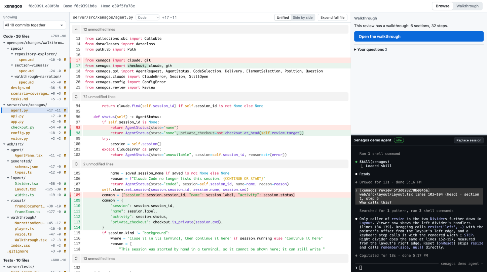
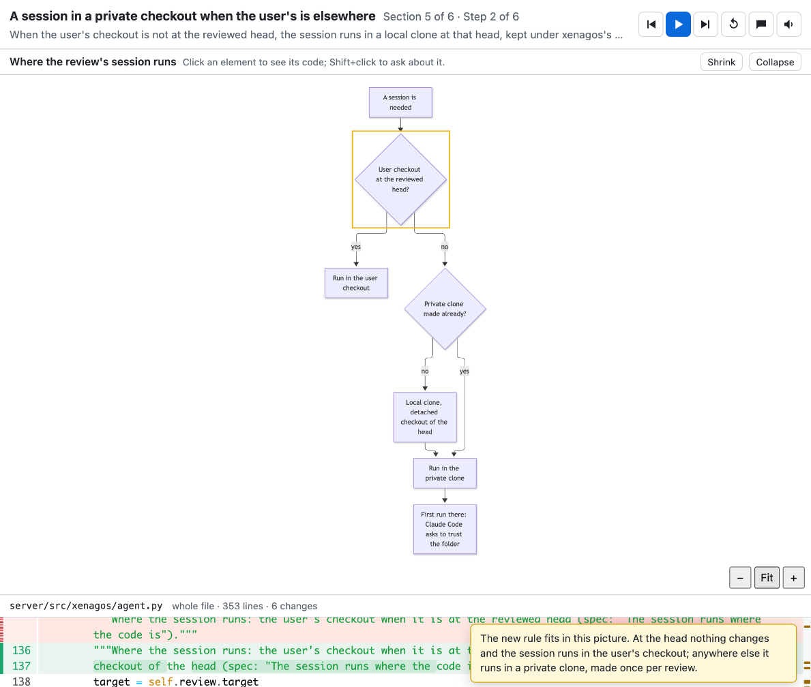
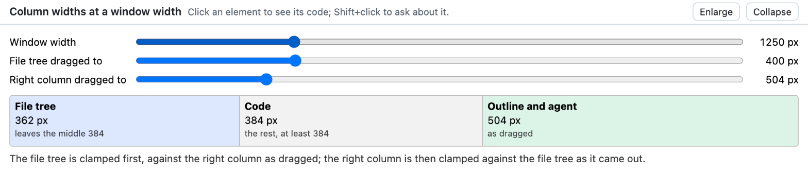
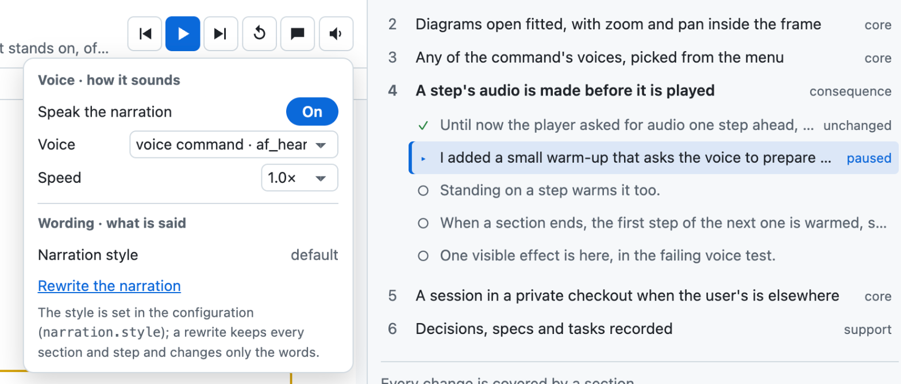

# xenagos

xenagos shows you a code change the way its author would explain it. It opens the change in your browser as whole
files with the changes marked in place, plays a narrated walkthrough that moves a spotlight across the code step by
step, and keeps a Claude Code session beside it that you can ask about any line.

The aim is to understand a change, not to hunt for bugs in it: to come away knowing what it does, why, and how its
parts fit together.


*Ξεναγός (xenagós) is Greek for a guide who shows visitors around.*

## Requirements

- macOS. Linux should work but has not been tried; Windows is not supported.
- [Claude Code](https://claude.com/claude-code), recent enough to run background sessions (tested with 2.1.330), and
  signed in.
- git.
- [uv](https://docs.astral.sh/uv/), which also provides Python 3.12 or newer if you don't have it.
- Node.js 22 or newer with npm, only to build the viewer during installation.
- make.
- A current browser for the viewer (tested with Chrome).

## Install

> **Installing with Claude Code:** you can ask Claude Code to *"install xenagos from https://github.com/sque/xenagos,
> following the Install section of its README"*. The steps below are written so that it can carry them out and check
> each one.

1. Check the tools are there. Each command should print a version:

   ```sh
   git --version && uv --version && node --version && npm --version && make --version && claude --version
   ```

   Install whatever is missing (on macOS: `brew install uv node`; Claude Code from its own site).

2. Get the source and build it. The build compiles the viewer and bundles it into a Python package, so Node is not
   needed after this step:

   ```sh
   git clone https://github.com/sque/xenagos.git
   cd xenagos
   make build
   ```

   This ends by writing `server/dist/xenagos-<version>-py3-none-any.whl`.

3. Install the `xen` command from that package:

   ```sh
   uv tool install --force server/dist/xenagos-*.whl
   ```

   If `xen` is then not found, run `uv tool update-shell` and open a new terminal.

4. Install the Claude Code skill, which teaches your own Claude Code sessions the `xen` commands (sessions that
   xenagos starts itself load it on their own):

   ```sh
   xen skill install
   ```

   It is copied to `~/.claude/skills/xenagos`.

5. Check it works:

   ```sh
   xen --version
   ```

### Update

From the `xenagos` folder:

```sh
git pull
make clean build
uv tool install --force --reinstall --no-cache server/dist/xenagos-*.whl
xen skill install --force
```

`--reinstall --no-cache` matters: while the version number stays the same, uv would otherwise reuse the package it
cached the first time.

### Uninstall

```sh
uv tool uninstall xenagos
rm -r ~/.claude/skills/xenagos
```

Reviews, their walkthroughs and xenagos's private checkouts stay in `~/.local/share/xenagos/`, and your settings in
`~/.config/xenagos/`. Remove those folders too if you want nothing left.

## Quick start

There are two ways in. Both end with the review open in your browser and a Claude Code session as its agent.

**From Claude Code** (after `xen skill install`). In a session inside your repository, ask:

> Open a xenagos review of this branch and walk me through it.

The session runs `xen open`, which opens the review in your browser with that session as its agent, writes the
walkthrough, and gives you the link. A session you started in a terminal cannot be shown in the viewer's agent pane,
but it still points at code in the viewer while you talk to it in the terminal. To move it into the pane, so that you
can also ask from the viewer, quit it in the terminal and press **Continue it here** in the pane.

**From a terminal.** In your repository:

```sh
xen                    # this branch against the default branch
xen main...feature     # from the fork point of main and feature
xen v1.2..v1.3         # directly between two commits
xen 4fdcc7e            # one commit
xen --base develop     # this branch against develop
```

The viewer opens in your browser in *browse* mode. Press **Ask the agent for a walkthrough**: xenagos starts a
Claude Code session in the background, shown in the right-hand pane, and the walkthrough appears when the session has
written it.

A review keeps running while its page is open and stops by itself after 30 minutes without a viewer. What you did in
it is kept: running the same `xen` command again brings back the review with its walkthrough, questions and place in
the walkthrough.

```sh
xen list               # open reviews
xen stop <id>          # stop one (xen stop --all for every one)
```

## Using the viewer

### Browse the change



The left column lists the changed files; the middle shows one whole file at a time with its changes marked in place,
so you read each change with the code around it. The marks beside the scroll bar show where the changes are in the
file. Drag the dividers to resize the side columns.

### Follow the walkthrough


A walkthrough is a few sections, each about one idea of the change, made of short steps. Each step scrolls to its
code, puts a spotlight on it and shows a caption, read aloud if the voice is on. The outline lists every section and
step; click one to play from there. *Not covered* lists the changes no section explains.

| Key | Action |
| --- | --- |
| Space or K | Play, pause, resume |
| ← or J / → or L | Previous / next step |
| R | Replay the step |
| C | Hide the caption |

### Ask about the code


Select lines by dragging over their line numbers and ask your question in the box that opens. The question goes to
the review's Claude Code session in the right-hand pane, with a reference to the lines and to where you are in the
walkthrough. While it answers, the agent can point at other code in the viewer (a caller, a definition, the old
version of a line). The pane is the real session: you can also type to it directly.

You can ask the agent for fixes too. While the review is open it edits the files without committing, because a
commit moves the branch and would start a new review.

### Diagrams and widgets



A section can carry visuals made by the agent: small HTML pages shown in a sandboxed frame, usually a diagram (Mermaid
is built in) or an interactive widget. Steps can highlight parts of them. Use − Fit + or the mouse to zoom and pan, click an element to see its code, and Shift+click
it to ask about it.



## Voice and narration



The speaker button opens the narration menu: turn the voice on or off, pick a voice and set its speed. With the voice
off, steps still advance at reading pace. By default xenagos uses the browser's own voices. Some of those are online
voices that send the text to the browser's vendor; the menu marks them, and the viewer says so before the first use
of one.

### A voice command

Instead of the browser, a program you choose can speak the narration. It gets the text of each step on standard input
and writes an audio file; xenagos makes each step's audio before it plays it, and caches it. Settings go in
`~/.config/xenagos/config.toml` (see [Configuration](#configuration)).

macOS's built-in `say`:

```toml
[voice]
provider = "command"
name = "Samantha"
command = ["say", "-v", "{voice}", "-r", "{rate}", "--data-format=LEI16@22050", "-o", "{output}"]
```

In the command, `{output}` is the file to write, `{voice}` is `voice.name`, `{speed}` is `voice.speed`, and `{rate}`
is the speed in words a minute (175 at speed 1). The command runs without a shell. If it sends the text off this
machine, set `off_machine = true` so the viewer says so before using it.

### Kokoro, a local neural voice

[Kokoro](https://github.com/thewh1teagle/kokoro-onnx) sounds far more natural than `say` and runs entirely on your
machine. Setting it up downloads about 350 MB of model files.

```sh
V=~/.local/share/xenagos/voices
mkdir -p "$V/kokoro/model"
uv venv --python 3.12 "$V/kokoro/venv"
uv pip install --python "$V/kokoro/venv" kokoro-onnx soundfile
curl -L -o "$V/kokoro/model/kokoro-v1.0.onnx" \
  https://github.com/thewh1teagle/kokoro-onnx/releases/download/model-files-v1.0/kokoro-v1.0.onnx
curl -L -o "$V/kokoro/model/voices-v1.0.bin" \
  https://github.com/thewh1teagle/kokoro-onnx/releases/download/model-files-v1.0/voices-v1.0.bin
cp extras/kokoro-say.py "$V/"
```

Then in `~/.config/xenagos/config.toml`, with your home folder written out in full (TOML does not expand `~`):

```toml
[voice]
provider = "command"
name = "af_heart"
# Kokoro voices the narration menu offers, so you can switch while listening.
# af_ / am_ are American (female / male), bf_ / bm_ British.
choices = ["af_heart", "af_bella", "af_nicole", "am_michael", "am_fenrir", "bf_emma", "bf_isabella", "bm_george", "bm_lewis"]
command = [
  "/Users/you/.local/share/xenagos/voices/kokoro/venv/bin/python", "-I",
  "/Users/you/.local/share/xenagos/voices/kokoro-say.py",
  "--voice", "{voice}", "--speed", "{speed}", "--output", "{output}",
]
```

### Narration styles

The style decides how the narration is worded. Two are built in: `default`, and `terse` for shorter steps. Choose
one with `narration.style`; it applies to the next walkthrough the agent writes.

A style is a folder named after it, holding `style.md` (the narrator's voice, with examples; the agent reads it
before writing) and optionally `limits.toml`, checked when the narration is submitted:

```toml
max_sentences_per_step = 3
max_words_per_step = 60
max_steps_per_section = 6
forbid = ["\\bsimply\\b", "\\bjust\\b"]   # patterns the narration must not contain
```

xenagos looks for a style in the repository's `.xenagos/styles/<name>/`, then in `~/.config/xenagos/styles/<name>/`,
then among the built-in ones.

## Configuration

Settings are read from `~/.config/xenagos/config.toml` (or `$XDG_CONFIG_HOME/xenagos/`), then from the reviewed
repository's `.xenagos/config.toml`, key by key, the repository's winning. An unknown setting or a bad value is
reported with its file and name. Files are read on each use, so an edit applies to the next review without
restarting anything.

| Setting | Default | Meaning |
| --- | --- | --- |
| `agent_open` | `"window"` | When an agent runs `xen open`: open the browser (`"window"`) or only give the link (`"link"`). |
| `idle_minutes` | `30` | Stop a review after this long without a viewer. |
| `unopened_hours` | `24` | Stop a review that was never opened after this long. |
| `session.name` | `"review {repo} {branch}"` | Name of the sessions xenagos starts; `{repo}`, `{branch}` and `{review}` are filled in. |
| `session.permission_mode` | Claude Code's default | Permission mode for those sessions, as `claude --permission-mode` takes it. |
| `narration.style` | `"default"` | The narration style. |
| `voice.enabled` | `true` | Whether the voice is on when the viewer opens. |
| `voice.provider` | `"browser"` | `"browser"` or `"command"`. |
| `voice.name` | none | The voice to start with. |
| `voice.speed` | `1.0` | Speaking speed. |
| `voice.command` | none | The program that speaks, for the `command` provider. |
| `voice.off_machine` | `false` | Set when the command sends the text off this machine. |
| `voice.choices` | `[]` | The command's voices that the narration menu offers. |

## Security and privacy

- **The viewer is local and needs the review's secret.** Each review's server listens on `127.0.0.1` only and
  answers only requests carrying the secret from the link `xen` prints. Treat that link like a password: anyone who
  can reach your machine's loopback with it can see the code and type into the agent's session.
- **The agent pane is a real Claude Code session**, with your account, your permission settings and the tools you
  allowed. Questions you ask in the viewer are sent to it as messages.
- **Your checkout is left alone.** When your checkout is not at the reviewed commit, the session works in a private
  clone under `~/.local/share/xenagos/checkouts/`, and the viewer says so. Browsing reads git's object store and needs
  no checkout at all.
- **A repository's `.xenagos/` folder is trusted.** Its `config.toml` can set `voice.command`, a program xenagos runs,
  and `session.permission_mode`; its styles are read by the agent. Before reviewing a change you do not trust, check
  that folder in your checkout.
- **Narration text** stays on your machine unless you choose an online browser voice or a command marked
  `off_machine`; the viewer says so before the first use of either.
- **Stored data:** reviews, walkthroughs, your questions and cached audio are kept in `~/.local/share/xenagos/`.

## Status

xenagos is an early prototype, built and used by one person. Expect rough edges and changes. Known limits:

- Questions you ask are kept with the review, but the answers live only in the agent's conversation.
- A commit to the reviewed branch starts a new review without the walkthrough; the old one keeps the reviewed
  commits.
- There is no command yet to clean up old reviews' data and private checkouts; remove them from
  `~/.local/share/xenagos/` by hand.

## Development

```sh
make check        # server: ruff, mypy, pytest; viewer: type checks, lint, tests
make check-web    # the viewer's checks only
make types        # regenerate the shared schema and TypeScript types after changing server models
```

The server is Python (FastAPI) in `server/`, the viewer React and Vite in `web/`. Specifications live in
`openspec/specs/`.

## License

[MIT](LICENSE)
